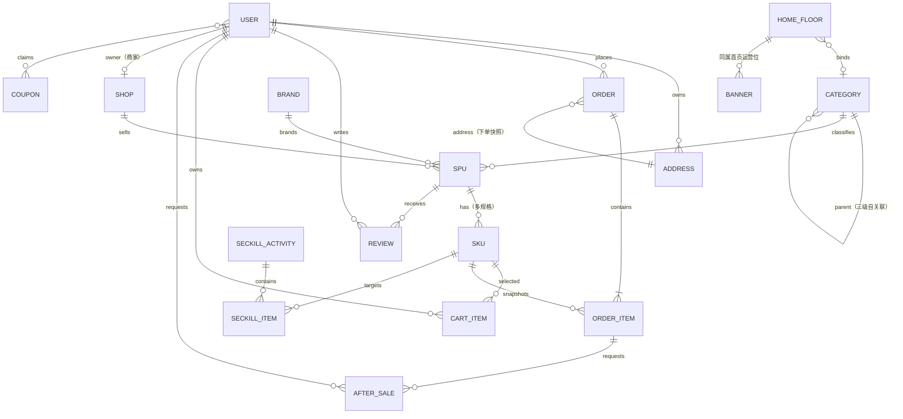

# ER 图

## 关键字段与约束

| 表 | 关键字段 | 说明 |
| --- | --- | --- |
| `User` | `username`(unique)、`role` | `buyer` / `merchant` / `console` 三角色共用一张表，`username` 即手机号 |
| `Category` | `parent`、`level`、`enabled`、`sort` | 三级自关联，`level ∈ {1,2,3}`；停用后前台隐藏 |
| `Shop` | `owner`、`approved`、`enabled` | 商家账号与店铺一对一；`approved=False` 为待审核 |
| `Spu` | `status`、`image_seed`、`sales`、`review_count` | `status`: draft / pending / on / off / rejected |
| `Sku` | `specs`(JSON)、`price`、`market_price`、`stock` | `specs` 形如 `{"颜色":"曜石黑","版本":"标准版"}` |
| `CartItem` | `(user, sku)` 唯一约束 | 同规格累加数量，受库存上限约束 |
| `Order` | `order_no`(unique)、`batch_no`、`status` | 一次结算按店铺拆单，共用 `batch_no` |
| `OrderItem` | `title_snapshot`、`specs_snapshot`、`price_snapshot` | 快照字段，商品改价不影响历史订单 |
| `AfterSale` | `order_item`、`status`、`amount` | 同意退款时回补库存并置订单 `refunded` |
| `Coupon` | `amount`、`threshold`、`total`、`claimed` | `users` 多对多记录领取关系，防重复领取 |

索引：`Spu(status, category)`、`Order(user, status)`、`Category(parent, enabled)`、`Order.batch_no`。

金额统一 `Decimal(10, 2)`，前端仅做展示格式化，计算全部在后端完成。
