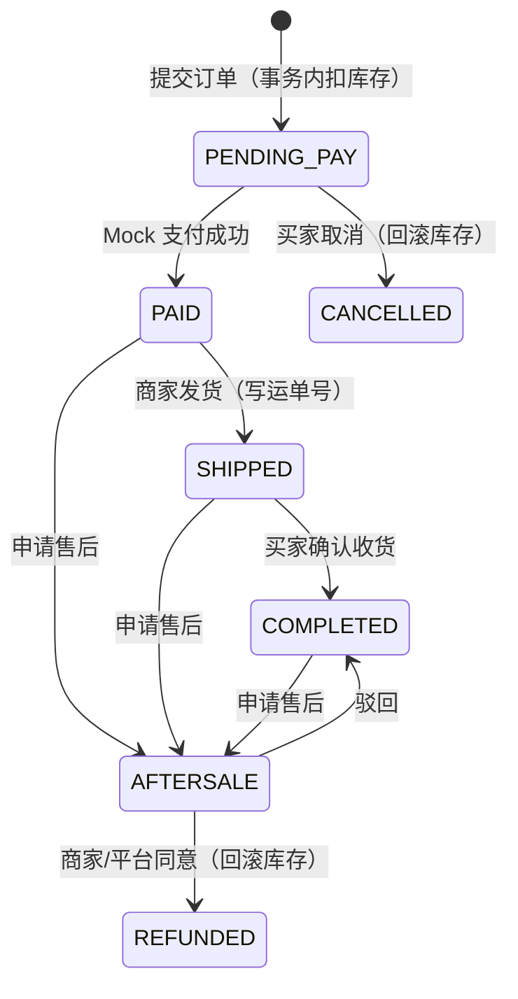

# 订单状态机

## 状态与文案

| 状态值 | 展示文案 | 买家可操作 | 商家可操作 | 平台可操作 |
| --- | --- | --- | --- | --- |
| `pending_pay` | 等待付款 | 付款、取消 | — | 查询 |
| `paid` | 等待发货 | 申请售后 | 发货 | 查询 |
| `shipped` | 等待收货 | 确认收货 | — | 查询 |
| `completed` | 已完成 | 评价、申请售后 | — | 查询 |
| `cancelled` | 已取消 | — | — | 查询 |
| `aftersale` | 售后中 | 查看进度 | 同意 / 驳回 | 同意 / 驳回 |
| `refunded` | 已退款 | — | — | 查询 |

## 库存与金额一致性

- 下单：`transaction.atomic()` + `Sku.objects.select_for_update()`，校验上架状态与库存后再扣减；
  购物车勾选项按 `shop` 分组，**每个店铺生成一笔订单**，共用同一个 `batch_no`。
- 取消：仅允许 `pending_pay`，事务内按订单项回补库存。
- 售后同意（商家端 / 平台端）：回补该订单项库存，订单状态置 `refunded`。
- 售后驳回：订单回到 `completed`，库存保持已扣减状态。
- 金额：`subtotal` 为商品小计，`freight` 满 99 免运费否则 8 元，`total = subtotal + freight`；
  订单项保存 `title_snapshot` / `specs_snapshot` / `price_snapshot`，商品后续改价不影响历史订单。
